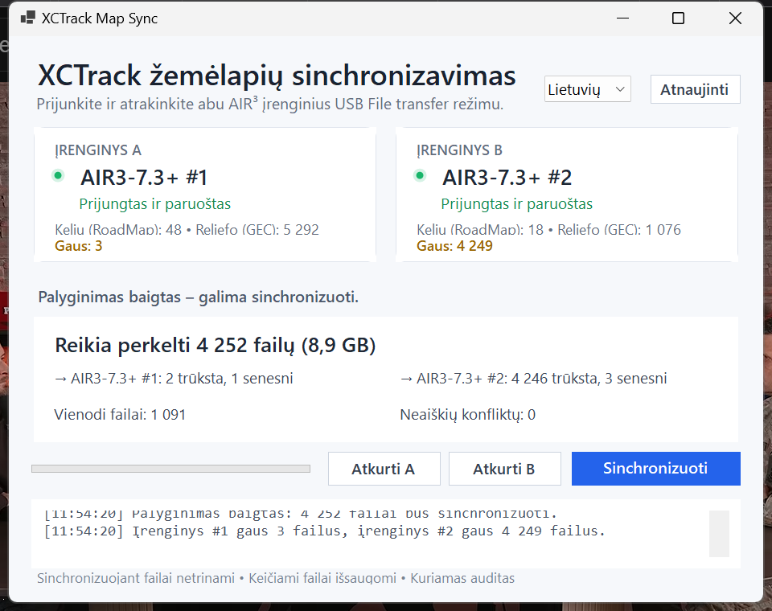
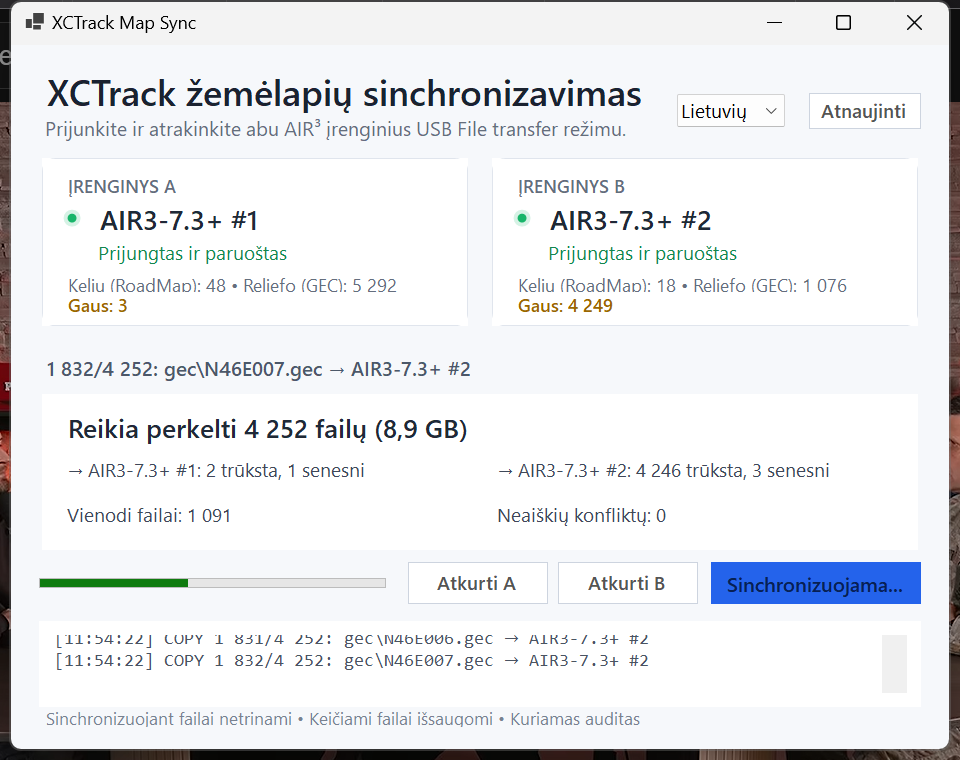
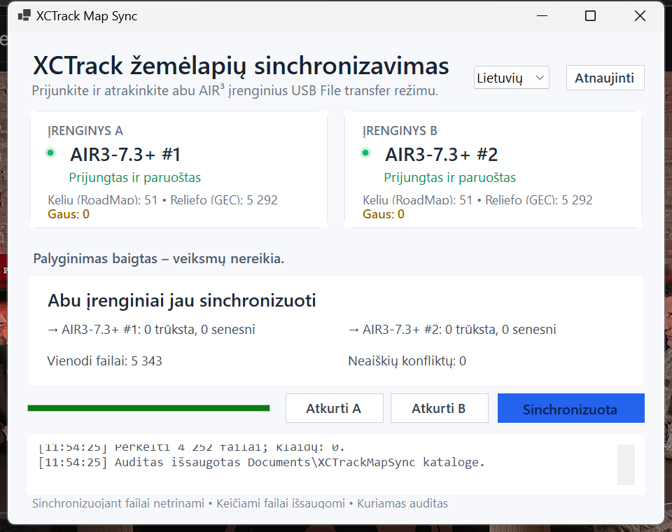

# XCTrack žemėlapių sinchronizavimas

> **Kalbos / Languages:** programa ir dokumentacija pateikiama **lietuvių** ir
> **anglų** kalbomis: **[Lietuviškai](README-LT.md)** · **[English](README.md)**

## Greita pradžia

1. Iš naujausio **[GitHub Release](https://github.com/Maeovaras/xctrack-map-sync/releases/latest)**
   atsisiųskite `XCTrackMapSync.exe`.
2. Jei Windows paprašys, įdiekite
   **[.NET 10 Desktop Runtime](https://dotnet.microsoft.com/en-us/download/dotnet/10.0)**.
3. Abiejuose įrenginiuose uždarykite XCTrack ir juos atrakinkite. Kiekvienam
   USB ryšiui pasirinkite **USB controlled by: This device** ir
   **File transfer**.
4. Abu įrenginius prijunkite prie to paties Windows kompiuterio ir Windows
   Explorer dukart spustelėkite `XCTrackMapSync.exe`.
5. Palaukite palyginimo, patikrinkite pakeitimus ir spauskite
   **Sinchronizuoti**. Iki pabaigos neatjunkite ir neužrakinkite įrenginių.
6. Jei norite atšaukti paskutinį vieno įrenginio sinchronizavimą, prijunkite tą
   įrenginį ir spauskite **Atkurti A** arba **Atkurti B**.

Viskas – terminalo naudoti nereikia. Viršutiniame dešiniajame kampe pasirinkite
**Lietuvių** arba **English**; programa pasirinktą kalbą įsimena.

XCTrack Map Sync – nepriklausoma Windows programa, dvikrypčiai
sinchronizuojanti XCTrack kelių žemėlapius ir reljefo failus tarp dviejų
Android MTP įrenginių, įskaitant suderinamus AIR³ įrenginius.

Programa:

- aptinka du prijungtus ir atrakintus XCTrack įrenginius;
- palygina `Map/RoadMap` ir `Map/gec` katalogus;
- parodo, kuriame įrenginyje trūksta failų arba yra senesnių versijų;
- dvikrypčiai nukopijuoja trūkstamus failus;
- skirtingo dydžio senesnį failą pakeičia tik tada, kai naujesnė pusė aiški;
- sinchronizavimo metu failų netrina;
- po sinchronizavimo sukuria vietinį atkūrimo tašką ir įrašo auditą;
- gali atkurti kiekvieno įrenginio būseną prieš paskutinį sinchronizavimą.

## Įrenginio atkūrimas

Mygtukai **Atkurti A** ir **Atkurti B** veikia atskirai. Programa parenka
naujausią pasirinktam įrenginiui tinkamą atkūrimo tašką. Pakeisti failai
grąžinami iš vietinės atsarginės kopijos, o tik to sinchronizavimo metu pridėti
failai pašalinami. Prieš pašalinimą programa dar išsaugo vietinę apsauginę jų
kopiją.

Uždarykite XCTrack ir iki atkūrimo pabaigos neatjunkite bei neužrakinkite
pasirinkto įrenginio. Atkūrimo duomenys ir CSV auditai saugomi
`Documents\XCTrackMapSync` kataloge.

## Ekrano nuotraukos

| Įrenginių palyginimas | Sinchronizavimas | Baigta |
|---|---|---|
|  |  |  |

## Išsamesnė dokumentacija

- **[Techninė dokumentacija lietuviškai](docs/README-TECHNICAL-LT.md)**
- **[Technical documentation in English](docs/README-TECHNICAL.md)**
- [Licencija](LICENSE) ir [trečiųjų šalių informacija](THIRD_PARTY_NOTICES.md)

Sinchronizavimo metu programa žemėlapių failų netrina. Atkūrimo metu ji
pašalina tik pasirinkto sinchronizavimo pridėtus failus, prieš tai išsaugojusi
vietinę apsauginę kopiją. Svarbius failus vis tiek rekomenduojama saugoti ir
atskiroje atsarginėje kopijoje.

## Prekių ženklai ir nepriklausomumas

Tai nepriklausomas bendruomenės projektas. Jis nėra susijęs su XContest,
XCTrack ar AIR³, nėra jų remiamas ar oficialiai patvirtintas. Produktų ir
prekių ženklų pavadinimai naudojami tik suderinamumui aprašyti. Visi prekių
ženklai priklauso jų savininkams.

## Licencija

Projektas platinamas pagal MIT licenciją. Žr. [LICENSE](LICENSE) ir
[THIRD_PARTY_NOTICES.md](THIRD_PARTY_NOTICES.md).
