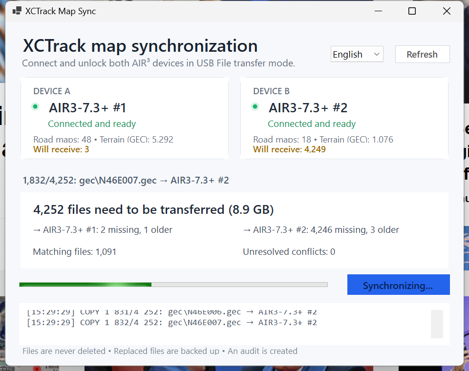
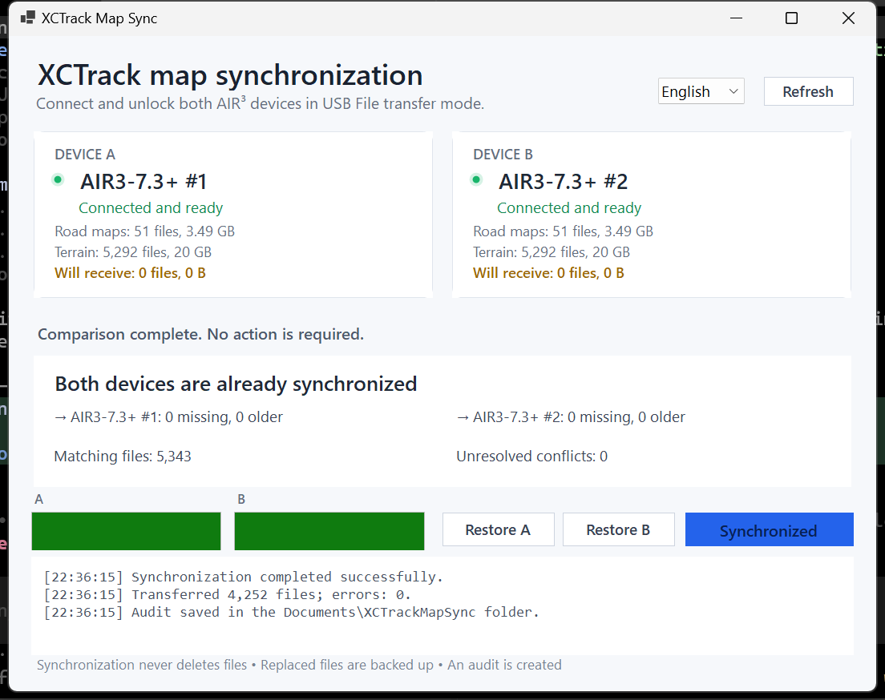

# XCTrack Map Sync

> **Languages / Kalbos:** The application is available in **English** and
> **Lithuanian (Lietuvių)**. Documentation: **[English](README.md)** ·
> **[Lietuviškai](README-LT.md)**

## Quick start

1. Download `XCTrackMapSync.exe` from the latest
   **[GitHub Release](https://github.com/Maeovaras/xctrack-map-sync/releases/latest)**.
2. If Windows asks for it, install the
   **[.NET 10 Desktop Runtime](https://dotnet.microsoft.com/en-us/download/dotnet/10.0)**.
3. Close XCTrack and unlock both devices. For each USB connection, select
   **USB controlled by: This device** and **File transfer**.
4. Connect both devices to the same Windows PC and double-click
   `XCTrackMapSync.exe` in Windows Explorer.
5. Wait for the comparison, review the changes, and click **Synchronize**.
   Keep both devices connected and unlocked until it finishes.
6. If you need to undo the latest synchronization for one device, connect that
   device and click **Restore A** or **Restore B**.

That is all. No terminal is required. Choose **English** or **Lietuvių** in the
upper-right corner; the application remembers your choice.

XCTrack Map Sync is an independent Windows utility for bidirectionally
synchronizing XCTrack road maps and terrain files between two Android MTP
devices, including compatible AIR³ devices.

The application:

- detects two connected and unlocked XCTrack devices;
- shows an AIR³ device as USB / MTP connected in under two seconds on a warm
  restart, then validates its XCTrack map folders in the background;
- uses a left-to-right progress bar for checking, synchronization, and restore
  instead of an indeterminate animation;
- compares `Map/RoadMap` and `Map/gec`;
- shows the current file count and total size for road maps and terrain on each device;
- shows which device is missing files or has older versions;
- copies missing files in both directions;
- replaces an older different-size file only when the newer side is clear;
- never deletes files during synchronization;
- creates a local restore point and audit log after synchronization;
- can restore either device to its state before its latest synchronization.

## Restore a device

The **Restore A** and **Restore B** buttons operate independently. The app uses
the newest matching restore point for the selected device. It restores replaced
files from the local backup and removes files that were added only by that
synchronization. Before removing an added file, it saves another local safety
copy.

Close XCTrack and keep the selected device connected and unlocked until the
restore finishes. Restore data and CSV audits are stored under
`Documents\XCTrackMapSync`.

## Screenshots

| Device comparison | Synchronizing | Complete |
|---|---|---|
|  |  |  |

## More documentation

- **[Technical documentation in English](docs/README-TECHNICAL.md)**
- **[Techninė dokumentacija lietuviškai](docs/README-TECHNICAL-LT.md)**
- [License](LICENSE) and [third-party notices](THIRD_PARTY_NOTICES.md)

Synchronization never deletes map files. Restore intentionally removes files
that the selected synchronization added, but only after saving a local safety
copy. Important files should still have an independent backup.

## Trademarks and affiliation

This is an independent community project. It is not affiliated with, endorsed
by, or sponsored by XContest, XCTrack, AIR³, or their owners. Product and brand
names are used only to describe compatibility. All trademarks belong to their
respective owners.

## License

MIT. See [LICENSE](LICENSE) and [THIRD_PARTY_NOTICES.md](THIRD_PARTY_NOTICES.md).
