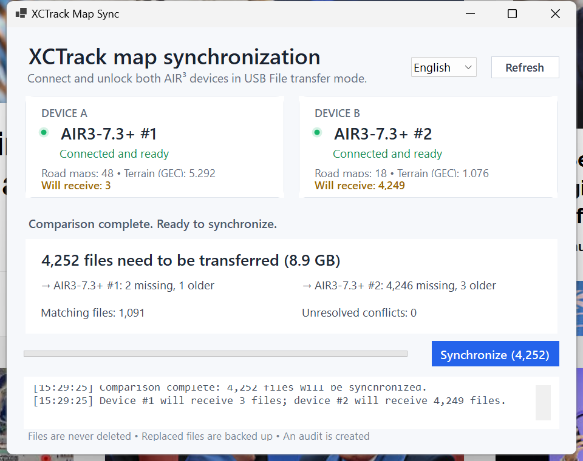

# XCTrack Map Sync

> **Languages / Kalbos:** The application is available in **English** and
> **Lithuanian (Lietuvių)**. Documentation: **[English](README.md)** ·
> **[Lietuviškai](README-LT.md)**

## Quick start

1. Download `XCTrackMapSync.exe` from the latest
   **[GitHub Release](https://github.com/Maeovaras/xctrack-map-sync/releases/latest)**.
2. If Windows asks for it, install the
   **[.NET 10 Desktop Runtime](https://dotnet.microsoft.com/en-us/download/dotnet/10.0)**.
3. Close XCTrack and unlock both devices. For each USB connection, select
   **USB controlled by: This device** and **File transfer**.
4. Connect both devices to the same Windows PC and double-click
   `XCTrackMapSync.exe` in Windows Explorer.
5. Wait for the comparison, review the changes, and click **Synchronize**.
   Keep both devices connected and unlocked until it finishes.

That is all. No terminal is required. Choose **English** or **Lietuvių** in the
upper-right corner; the application remembers your choice.

XCTrack Map Sync is an independent Windows utility for bidirectionally
synchronizing XCTrack road maps and terrain files between two Android MTP
devices, including compatible AIR³ devices.

The application:

- detects two connected and unlocked XCTrack devices;
- compares `Map/RoadMap` and `Map/gec`;
- shows which device is missing files or has older versions;
- copies missing files in both directions;
- replaces an older different-size file only when the newer side is clear;
- never deletes files;
- creates a local backup before replacement and writes an audit log.

## Screenshots

| Device comparison | Synchronizing | Complete |
|---|---|---|
|  |  |  |

## More documentation

- **[Technical documentation in English](docs/README-TECHNICAL.md)**
- **[Techninė dokumentacija lietuviškai](docs/README-TECHNICAL-LT.md)**
- [License](LICENSE) and [third-party notices](THIRD_PARTY_NOTICES.md)

The program never deletes map files, but important files should still have an
independent backup.

## Trademarks and affiliation

This is an independent community project. It is not affiliated with, endorsed
by, or sponsored by XContest, XCTrack, AIR³, or their owners. Product and brand
names are used only to describe compatibility. All trademarks belong to their
respective owners.

## License

MIT. See [LICENSE](LICENSE) and [THIRD_PARTY_NOTICES.md](THIRD_PARTY_NOTICES.md).
